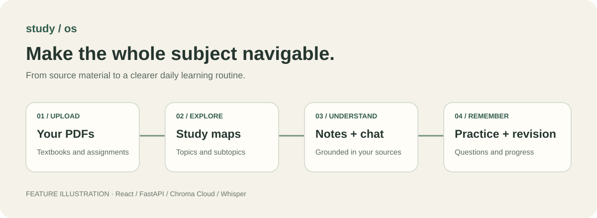
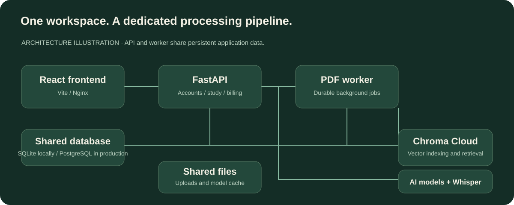

# Study OS

**Turn course PDFs into a workspace for understanding, practice, and revision.**

Study OS combines React and FastAPI to turn learning material into navigable
concept maps, source-backed notes, and practice. Students organize work by
semester and subject; professionals use folders for reference material.



## Features

| Feature | What you can do |
| --- | --- |
| PDF study maps | Upload textbooks and explore topics and subtopics in an interactive map. |
| Document questions | Ask questions using retrieval from uploaded material through Chroma Cloud. |
| Learning content and notes | Generate explanations and notes with references back to PDF pages. |
| Practice and assessment | Answer practice questions and topic tests with saved results. |
| Study planning | Track completion, progress, and revision tasks. |
| Assignments | Upload assignment PDFs and map their content to topics. |
| Lecture workspace | Record audio chunks, transcribe with local Whisper, and generate notes. |
| Account modes | Semesters and subjects for students; folders for professionals. |
| Authentication | Email/password, Google sign-in, email verification, and login abuse protection. |
| Plans and billing | Usage limits and Stripe subscription management. |
| Workspace controls | Light/dark themes and resizable panels. |

## Frontend preview

Run the frontend and open **Preview demo** to explore its built-in mock lesson,
concept visualization, and quiz without signing in. The preview does not exercise
live PDF processing or AI services.

The images here are feature illustrations, **not captured UI screenshots**.
See the [screenshot guide](docs/screenshots/README.md) for views to capture using
synthetic study material.

## Local development

Install Docker Engine or Docker Desktop with the Compose plugin.
Copy `backend/.env.example` to `backend/.env`. Set a unique `JWT_SECRET` of at least
32 bytes. For PDF indexing and AI features, configure `OPENAI_API_KEY`,
`CHROMA_API_KEY`, `CHROMA_TENANT`, and `CHROMA_DATABASE`. From the repository root:

```bash
docker compose up --build
```

The API is available on `http://localhost:8001` and the frontend on
`http://localhost:5173`. Compose applies Alembic migrations and starts a
separate durable PDF worker.

API documentation is at `http://localhost:8001/docs`; the health endpoint is
`http://localhost:8001/health`. The named `study_backend_data` volume persists the
database, uploads, and model cache.

Create an account and follow the verification link in `docker compose logs backend`
when `EMAIL_DELIVERY_MODE=console`. Create a semester and subject, upload a
text-based PDF, wait for processing, then open a topic from the map. Keep the
worker running. `docker compose down` stops services and retains named volumes.

`OUTLINE_LLM_ENABLED=false` keeps deterministic heading extraction.
`SUBTOPIC_CONSOLIDATION_ENABLED=false` also prevents the optional one-call
consolidation of PDFs with more than eight detected topics.

## Development without Docker

Use **Node.js 22**, **Python 3.12**, and FFmpeg for transcription to match Docker.
For the frontend, copy `frontend/.env.example` to `frontend/.env`, then:

```bash
cd frontend
npm ci
npm run dev
```

This is enough for the public demo. API-backed features require the backend.
From `backend/`, create a virtual environment with `python -m venv .venv`.
Activate with `.venv\Scripts\Activate.ps1` in PowerShell, or
`source .venv/bin/activate` on macOS/Linux. Then:

```bash
python -m pip install -r requirements.txt
python -m alembic upgrade head
python -m uvicorn app.main:app --reload --port 8001
```

In another terminal with the same environment activated, run from `backend/`:

```bash
python -m app.worker
```

Use `backend/requirements.txt` for backend dependencies, as Docker and CI do.
The root requirements file is a legacy snapshot.

## Configuration

See [backend/.env.example](backend/.env.example) for all development settings and
[frontend/.env.example](frontend/.env.example) for browser configuration.

| Settings | Purpose |
| --- | --- |
| `JWT_SECRET` | Unique random secret for authentication tokens. |
| `FRONTEND_URL`, `FRONTEND_ORIGINS` | Verification links and allowed browser origins. |
| `OPENAI_API_KEY`, `CHAT_MODEL` | Remote AI generation and document answers. |
| `CHROMA_API_KEY`, `CHROMA_TENANT`, `CHROMA_DATABASE` | Cloud indexing and retrieval. |
| `DATABASE_URL`, `APP_DATA_DIR` | Database and persistent storage. |
| `EMAIL_DELIVERY_MODE`, `SMTP_*` | Console verification locally; SMTP in production. |
| `GOOGLE_CLIENT_ID`, `VITE_GOOGLE_CLIENT_ID` | Matching Google web OAuth client IDs. |
| `STRIPE_SECRET_KEY`, `STRIPE_WEBHOOK_SECRET`, `STRIPE_PRICE_*` | Checkout, webhooks, recurring prices. |
| `LOCAL_TRANSCRIPTION_*` | Whisper model, device, precision, and cache. |
| `VITE_API_URL` | API address embedded at frontend build time. |

Google and Stripe are optional for basic local email-account development; their
related features need credentials. For Google login in development Compose, supply
`VITE_GOOGLE_CLIENT_ID` in the shell or root `.env`, plus `GOOGLE_CLIENT_ID` in the
backend environment. Frontend `VITE_*` values are public; keep service secrets in
backend configuration. Rebuild after changing frontend values.

Whisper downloads its model on first use. PDF extraction expects embedded text;
scanned documents may need OCR beforehand.

## Architecture



The API handles accounts, uploads, study workflows, and billing. A durable worker
processes queued PDFs. SQLAlchemy stores relational state; Chroma Cloud stores
searchable document chunks. Development uses SQLite; production uses PostgreSQL.
Whisper runs on the backend host.

```text
backend/app/           API, authentication, AI, PDF jobs, study logic
backend/migrations/    Alembic database migrations
backend/tests/         Backend unit tests
frontend/src/          React interface, API client, styles
deploy/                Caddy HTTPS proxy and AWS deployment guide
.github/workflows/     Automated build and unit checks
docs/                  Illustrations and screenshot guidance
```

## Validation

```bash
# From frontend/
npm run build

# From backend/
python -m unittest discover -s tests
```

GitHub Actions builds the frontend and runs backend unit tests on pushes and pull
requests. Tests cover authentication, account modes, security, billing, PDF jobs,
notes, organization, and study workflows. Live third-party integrations need
separate service checks.

## Production

- Generic single-host production: `docker-compose.prod.yml`
- AWS EC2 + RDS deployment: [`deploy/aws/README.md`](deploy/aws/README.md)

Both production configurations require real HTTPS domain, SMTP, Google,
Stripe, PostgreSQL, model, and vector-store credentials. The backend refuses
to start in production when any required safety configuration is absent.

For the generic production stack, copy `.env.production.example` to `.env` and
`backend/.env.production.example` to `backend/.env.production`, configure both, then:

```bash
docker compose --env-file .env -f docker-compose.prod.yml config
docker compose --env-file .env -f docker-compose.prod.yml up -d --build
```

Back up the database and uploads before migrations or redeployments. Follow the
AWS guide for DNS, SES, Google authorized origins, Stripe webhooks, and backups.

## Troubleshooting

- **PDF stays queued:** inspect `docker compose logs worker`; verify that API and
  worker share the database and data volume.
- **Upload or chat fails:** check Chroma Cloud and model credentials and service logs.
- **Missing local verification email:** use the link in backend console logs.
- **Browser cannot reach API:** check API URL, ports, and allowed origins; rebuild
  after changing frontend build values.
- **PowerShell blocks npm.ps1:** use `npm.cmd ci` and `npm.cmd run dev`.
- **Slow first transcription:** allow time for the initial model download.

## Contributing and license

See [CONTRIBUTING.md](CONTRIBUTING.md) for checks and pull request guidance.
Secrets, databases, uploads, recordings, downloaded models, dependencies, and
generated builds are excluded from Git. Commit example configuration and lockfiles.

No open-source license has been selected for this repository.
